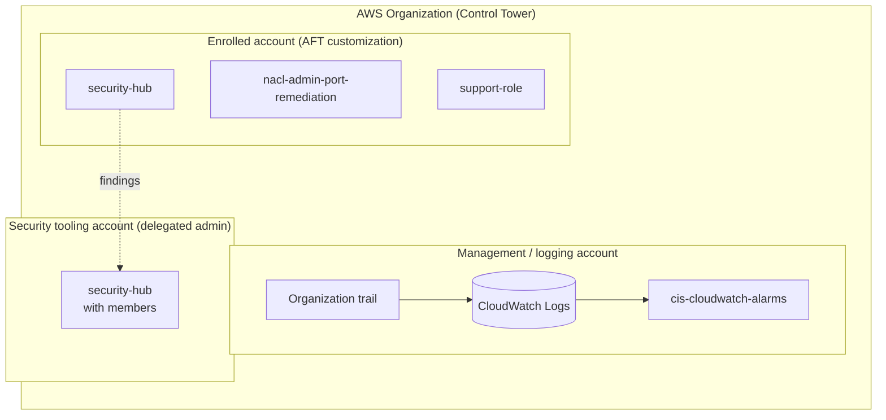
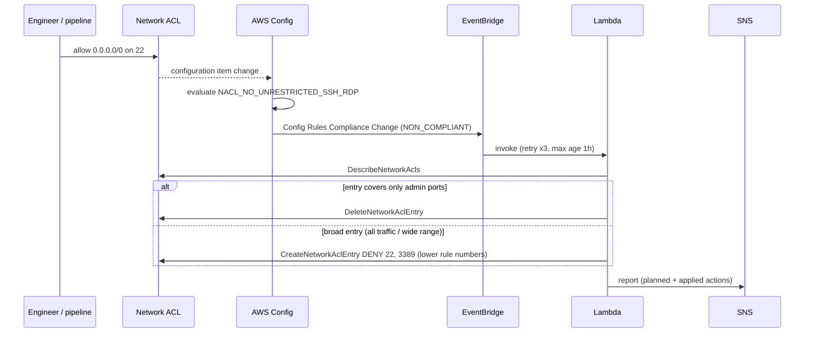

# Architecture

## Context

AWS Control Tower creates an organization CloudTrail whose events are delivered
to a CloudWatch Logs group (named `aws-controltower/CloudTrailLogs` by default)
and enables AWS Config in every enrolled account. Account Factory for Terraform
(AFT) then applies per-account "customizations" through a CodePipeline that
renders the Terraform provider and backend configuration at run time.

The guardrails in this repository plug into those building blocks rather than
re-creating them: they never create a trail, a configuration recorder or an
organization.



## Module 1: `cis-cloudwatch-alarms`

### Data model

```text
local.cis_controls  (static catalogue, 15 entries)
        │  filtered by var.enabled_controls (null = all)
        ▼
local.controls      (resolved: names, severity, final pattern)
        │  for_each
        ├──► aws_cloudwatch_log_metric_filter.this["4.x"]
        └──► aws_cloudwatch_metric_alarm.this["4.x"] ──► SNS topic
```

- The **key is the CIS control ID** (`"4.1"` ... `"4.15"`). It is stable, human
  readable, and appears in resource addresses
  (`aws_cloudwatch_metric_alarm.this["4.3"]`), in outputs and in alarm names.
  Removing a control from `enabled_controls` destroys only that control.
- A control either carries a raw `pattern` (4.1, 4.2, 4.3, 4.6 need operators
  other than `eventName` equality) or an `event_source` + `event_names` list
  from which the pattern is generated.
- The alarm references the filter's `metric_transformation[0].name`, which gives
  Terraform an explicit dependency (alarm after filter).

### Alerting

- `alarm_actions` always target SNS; `ok_actions` are opt-in to avoid doubling
  e-mail volume.
- The topic policy keeps account-owner permissions and only allows
  `cloudwatch.amazonaws.com` to publish when `aws:SourceAccount` is the current
  account and `aws:SourceArn` is a CloudWatch alarm of that account (confused
  deputy protection).
- Encryption: CloudWatch cannot use the AWS managed `aws/sns` key. The module
  therefore takes an optional customer managed key (`sns_kms_master_key_id`)
  whose key policy must allow `cloudwatch.amazonaws.com` to call
  `kms:Decrypt` and `kms:GenerateDataKey*`.

### Optional archiver

E-mail is not an audit trail. With `enable_sns_archiver = true`, a small Lambda
subscribed to the topic writes each notification to
`s3://<bucket>/<prefix>YYYY/MM/DD/<alarm-name>/<message-id>.json`. The role can
only `s3:PutObject` under that prefix. Path segments are sanitised so that a
crafted alarm name cannot escape the key layout.

## Module 2: `nacl-admin-port-remediation`



Design choices:

- **Do no harm.** Deleting an `allow all from 0.0.0.0/0` entry on a public
  subnet would cut every flow, including legitimate HTTPS. The Lambda only
  deletes entries that cover nothing but admin ports. Broad entries are
  shadowed by DENY entries inserted at free rule numbers just below them (NACL
  rules are evaluated in ascending order, first match wins).
- **Fail visible.** When no free rule number exists below the offending entry,
  nothing is changed and the report says `manual_action_required`.
- **Dry run.** `dry_run = true` produces the same report without any change;
  this is how the module should be rolled out first.
- **Pure core.** `plan_remediation()` is a pure function over the list of NACL
  entries. All decisions are unit-tested without AWS, boto3 or moto; the handler
  receives its clients by injection.
- **Least privilege.** `ec2:Describe*` is the only `*` resource (the action does
  not support resource-level permissions). Entry changes are restricted to
  network ACLs of the current account; `sns:Publish` to the module's topic.
- The notification topic can use `alias/aws/sns`: only the Lambda (an IAM
  principal of the account) publishes to it.

## Module 3: `security-hub`

- `standards` is a list of paths; ARNs are built from partition and region.
  CIS 1.2.0, which is published as a global `ruleset/`, is handled too.
- `enable_default_standards = false` keeps the list as the single source of
  truth.
- `control_finding_generator = "SECURITY_CONTROL"` produces one finding per
  control across standards (less noise when CIS and FSBP overlap).
- In an Organizations setup, member accounts are normally auto-enabled by the
  delegated administrator; `members`/`invite_members` exist for the standalone
  case. A precondition prevents an account from adding itself.

## Module 4: `support-role`

CIS 1.17 asks for a role that can open and manage AWS Support cases. Security
Hub (control IAM.18) checks that `AWSSupportAccess` is attached to some
principal. The trust policy accepts only explicit principal ARNs (validation
rejects wildcards) and requires MFA by default.

## Tagging

The landing zone enforces an AWS Organizations tag policy that only accepts
`environment`, `owner`, `createdby` and `account`. Each module validates
`var.tags` against that list so violations surface during `plan`.
